# ＝LOVEイントロクイズ

アイドルグループ ＝LOVE（イコールラブ）の曲で遊ぶ、スマホ向けの早押しイントロクイズです。イントロを聴いて、分かった瞬間に4つの曲名から1つをタップします。

**聴くほど分かる。でも、聴くほど点が減る。** 
長く聴けば当てやすくなるけれど、点は下がっていきます。どこで押すかを迷うのが、このゲームの中心です。

クイズで曲を覚えるだけでなく、**よく外す曲の練習**、**タイムや対戦での勝負**、**ライブのコールの予習**もできます。

**▶ まずは [作品紹介動画（YouTube）](https://youtu.be/-TZg9DNtfic) で、実際に遊んでいる様子をご覧ください。** 点数の仕組み、クイズの種類、友達との対戦、コールの予習、＝LOVE を調べる機能を、実際の画面で紹介しています。

  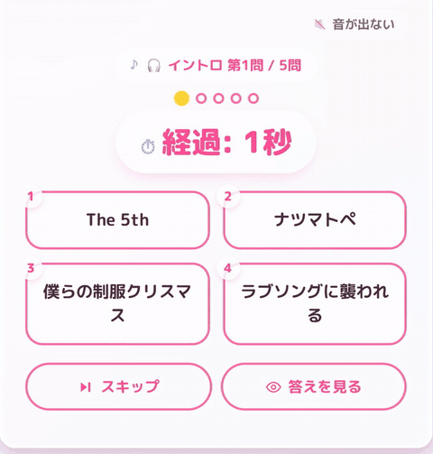

実際のプレイ画面（音なし・15秒）。1・2問目は3秒以内に答えて10点、3問目は外して正しい曲名が出ています。 右上の「🔇 音が出ない」は、音が鳴らないときに押すボタンです。

[公開アプリ](https://togashi-sota.github.io/equal-love-intro-quiz/)には音源が入っていないため、開いただけではクイズは始まりません（画面・遊び方ガイド・曲の一覧などは見られます）。遊ぶには、音源などのデータを、決まった形式のファイル（ZIP など）で端末に読み込む必要があります（データの扱いは[権利について](#権利について)）。操作だけなら、このアプリの元にした自分の別の作品 [Intro Dash](https://togashi-sota.github.io/intro-dash) で試せます（＝LOVE の曲は入っていません）。

**作品の情報**

- **＝LOVE とは**：指原莉乃さんがプロデュースするアイドルグループ（2017年デビュー）
- **遊ぶ人数**：ひとりで／1台を囲んで2〜4人／オンラインで最大10人（実際に試したのは3人・3台まで。[まだ確かめていないこと](#まだ確かめていないこと)）
- **対象**：＝LOVE のファン。最近ファンになった人から、ほとんどの曲を知っている人まで
- **対応曲**：84曲（音源はアプリに入っていません）。ライブで入れる掛け声（コール）の予習は46曲
- **制作**：個人制作・約15週（2026年7月〜11月）。企画・ルール・仕様の判断・実機での確認は自分。プログラムの実装の大部分は生成AIの Claude Code、仕様の整理やレビューの相談には ChatGPT を使いました
- **ほかの資料**：企画書・ポートフォリオ・詳細仕様書は、応募書類として別に提出しています（ルールや数値の細部は詳細仕様書）

> ⚠️ 非公式のファン制作物です。＝LOVE および権利者・関係各社とは関係ありません（[権利について](#権利について)）。

## このゲームのおもしろさ

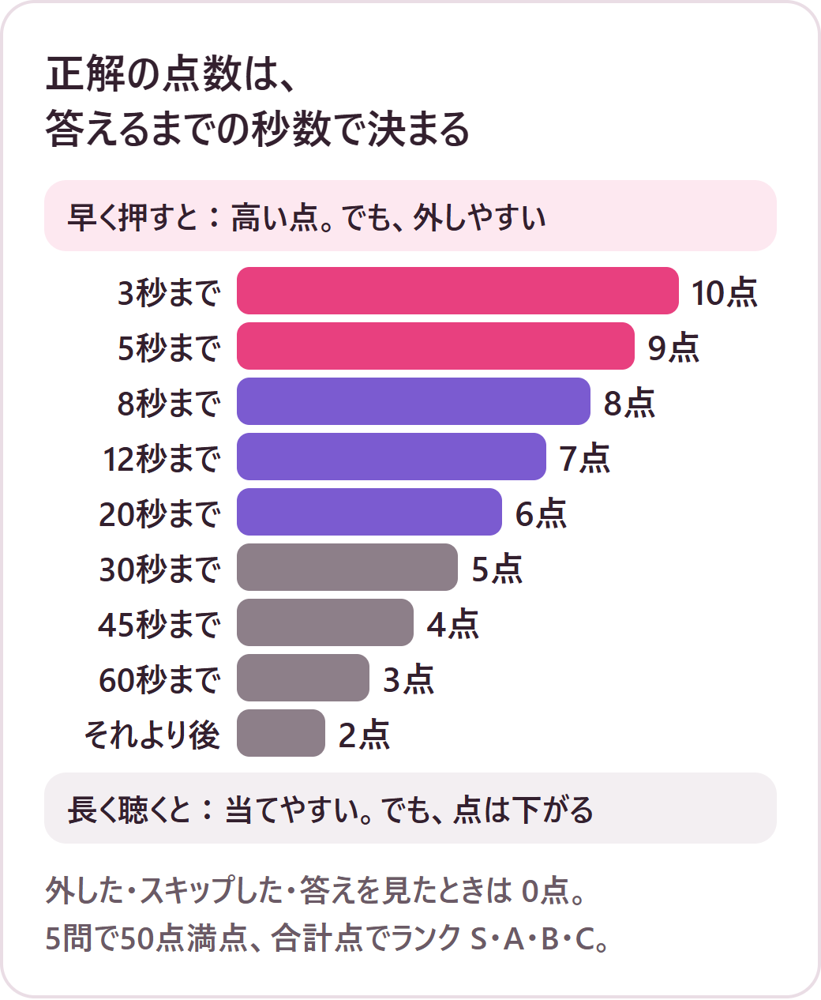

この README のグラフと図は、説明のために作ったものです（作図：Claude Code）。

ルールは「聴いて、分かったらタップ」だけです。点数は答えるまでの秒数で決まり、3秒以内なら10点、待つほど下がります。外したとき、スキップしたとき、答えを見たときは0点です。時間切れはないので、いつ押すかは自分で決めます。

そのため、「もう分かった気がするから押したい」と「外すと0点だから、もう少し聴きたい」の間で迷います。この迷いが一番おもしろいところだと考えています。曲の頭に無音がある曲は、その分を飛ばして、音が鳴る所から流します（今は1曲）。

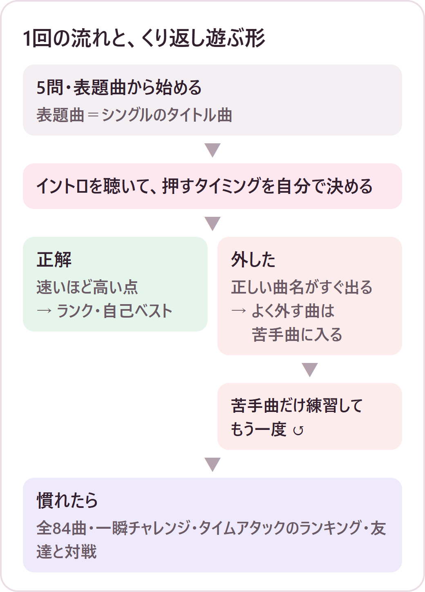

## 作った理由と遊んでほしい人

作った理由は3つです。自分が ＝LOVE を好きだから。「こんなゲームがあったらいいな」と思ったから。そして、友達にも ＝LOVE を知ってほしかったから。ゲームで遊んだり情報を見たりして「面白い」と思ってもらうことが、＝LOVE を知るきっかけになればと考えました。前に自分が作った別のイントロクイズ（Intro Dash）を元に、まず自分が遊ぶために作り始め、そこから友達と遊ぶための対戦などを足していきました。

遊ぶ人は2つのタイプを考えて、2週目に決めました。

- **最近ファンになって、曲をまだ全部は知らない人**：「5問・表題曲（シングルのタイトル曲）だけ」から気軽に始めて、よく外す曲は苦手曲で覚えられるようにしました。
- **ほとんどの曲を知っている人**：全84曲や一瞬チャレンジ、タイムアタックのランキングで、記録を詰められるようにしました。

収録曲は84曲と限られているので、同じ曲でも「聴かせ方」を変えて、何度も遊べるようにしました。曲の途中から、最後の5秒だけ、歌詞のヒントから、ほんの一瞬だけ（1.5／1／0.5秒）、というように、同じ曲が別の挑戦になります。

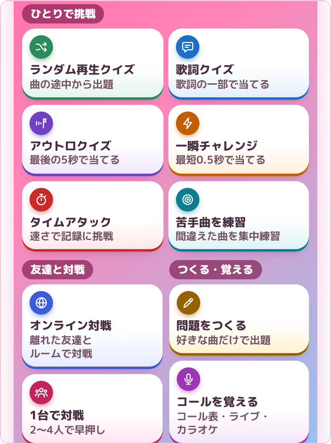

ホームの遊び方の一覧（基本のイントロクイズは、ホームのいちばん上の大きなボタンから始めます。画像には写っていません）

## 主な遊び方

### よく外す曲は、苦手曲に集まる

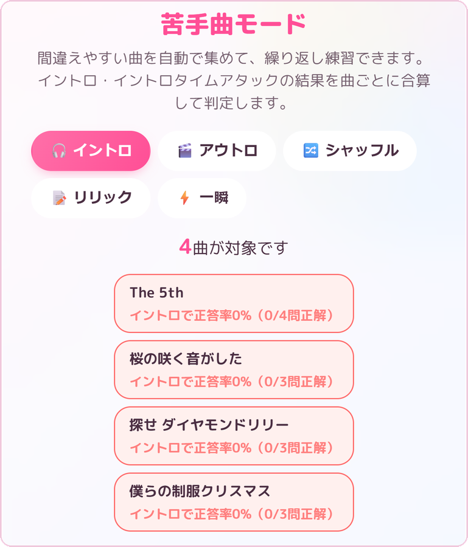

3回以上答えて、正解率が75%未満の曲が自動で集まります（画面の「シャッフル」は曲の途中から、「リリック」は歌詞のモードです）。この基準は、はじめは50%未満でしたが、自分で75%未満に変えました。

### タイムアタックとランキング

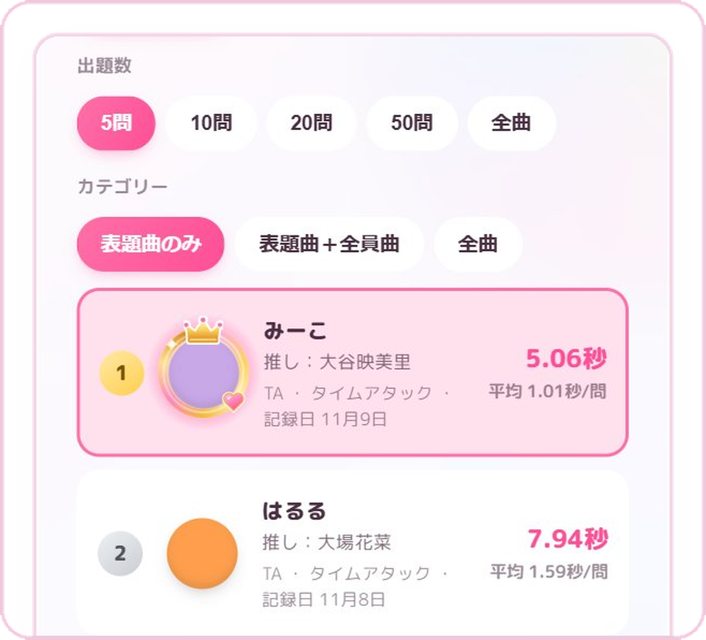

ミスなしで解いたタイムを、出題数・範囲ごとのランキング（TOP10）で競います。フレンド（公開設定を ON にした人の一覧。申請はありません）では、ほかの人の推しメンや称号も見られます。

### 友達と：1台を囲んで／離れていても

  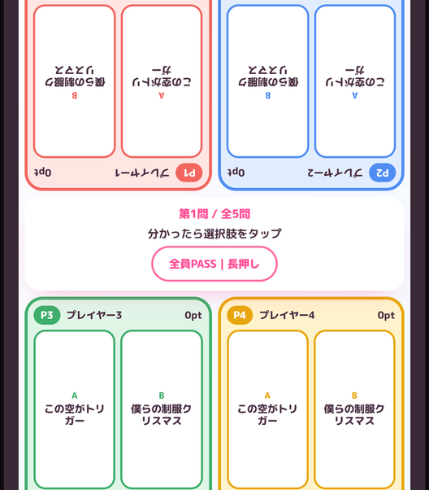
  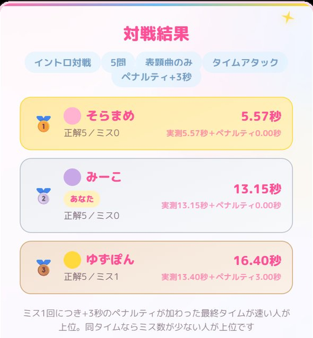

パーティー対戦（画面の中央部分。各席の4択のうち2つずつが写っています）　／　オンライン対戦の結果

- **パーティー対戦**：1台のスマホやタブレットを机に置き、2〜4人が自分の席のボタンで早押しします。向かいの席の文字は逆さまに出ます。
- **オンライン対戦**：離れた友達と同じ問題を同時に解きます（協力モードを含む6モード）。タイムを競うモードでは、ミス1回ごとに足す秒数（0〜10秒）を、部屋の設定で選べます。

### ライブのコールを予習する

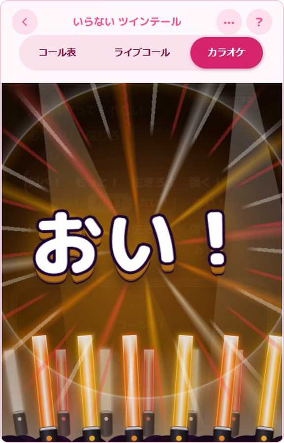

コールを曲に合わせて予習できます（46曲）。言うタイミングでコールが大きく出て光り、カラオケの表示では次のコールを「3・2・1」で予告します。声を聞いて判定する機能はなく、表示に合わせて自分で声を出す練習です。

スクリーンショットと GIF は、すべて実際のアプリです。名前（みーこ・そらまめ など）と記録は、撮影のために PC の中だけで動かしたテスト用のもので、実際の利用者の成績ではありません。

ほかの遊び方と機能（クリックで開く）

- **ひとりで**：イントロクイズ、ランダム再生クイズ（曲の途中から）、アウトロクイズ（最後の5秒）、歌詞クイズ、一瞬チャレンジ（1.5／1／0.5秒。聞き直しは何回でもできる）、タイムアタック、苦手曲を練習（5つの系統ごと）、問題をつくる（好きな曲で自分だけの問題セットを保存）
- **友達と**：パーティー対戦（お手つきのあり／なし、1位が同点ならサドンデス、曲名を声で答える方式もあり）、オンライン対戦（ルームコードかフレンドの招待で集まる。6モード・最大10人。協力モード、観戦・再戦・再接続・ホストの交代に対応）
- **ファンとして**：コールを覚える（コール表・ライブコール・カラオケ）、楽曲（一覧・検索・試聴、お気に入り、プレイリスト、オフラインの連続再生）、＝LOVE の年表・作品・ライブ・メンバーのページ、アプリ内の検索
- **記録**：プレイ履歴、自己ベスト、称号27種と勲章（アイコンのふちが4段階で豪華になる）、フレンド、クラウドバックアップ

## 遊んで見つけて直したこと

特に大事にしたのは、ボタンの置き方や押しやすさ、ゲームの進み方の分かりやすさです。自分の iPhone・iPad で実際に遊んだり、友達から連絡をもらったりして、引っかかったところを直すことを何度もくり返しました。どう直すかは自分で決め、プログラムの修正は Claude Code に頼みました。ここに書いた判断と理由は、どれも当時の開発の記録（引き継ぎの記録やコードの注記）にあるものです。どの事例も、最後に「まだ確かめていないこと」を書きました。

### 1. 回答ボタンの押し間違い

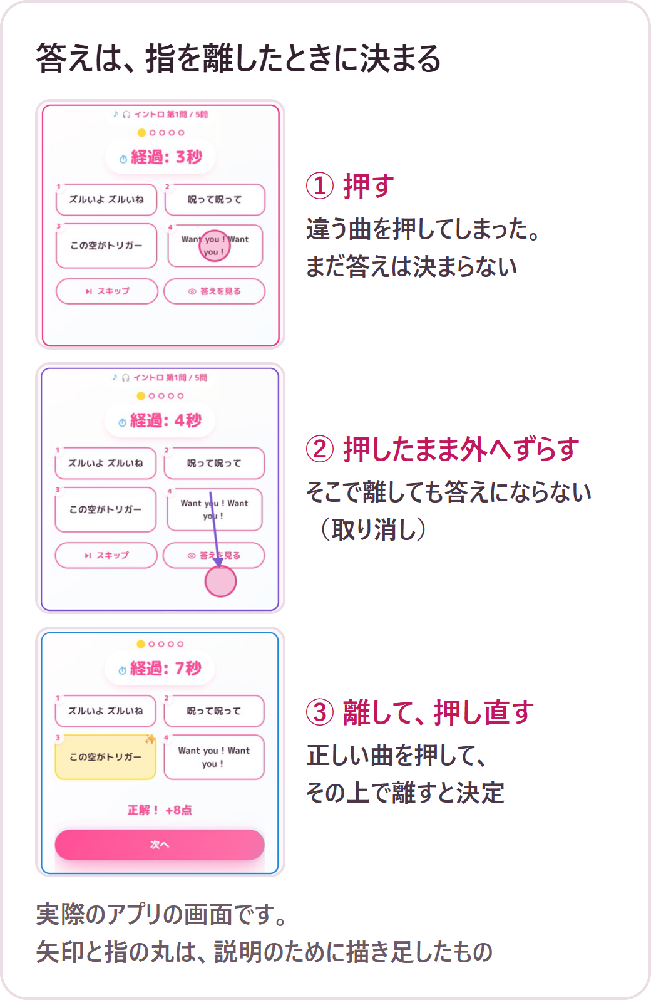

- **気づいたこと**：最初は、ボタンを押した瞬間に答えが決まっていました。早く押すほど点が高いので、急いで押すと隣のボタンに触れてしまい、それがそのまま答えになりました。自分の iPhone で遊んでいて気づきました。
- **判断と理由**：答えは、押した瞬間ではなく、指を離したときに決める。急いで押したときの押し間違いで、答えが決まらないようにするためです。
- **採用した仕様**：押したボタンの上（まわり約24pxまで。この値は実装のときに決めた）で指を離すと決定。それより外へずらすと取り消しで、ボタンの上に戻しても決まらない（指を離して押し直す）。4択のクイズと歌詞クイズに入れ、あとから作ったパーティー対戦も、ほかのクイズと同じ操作感にそろえました。
- **AI による実装**：Claude Code が、どの画面でも使える共通の処理として作りました。あとで、自分が歌詞クイズを遊んでいて「画面をスクロールすると答えが決まってしまう」不具合を見つけ、Claude Code が原因を調べて直しました（押し始めたときのボタンの位置を覚えておく方法）。
- **その後の変更**：そのあとも歌詞クイズでは、スクロール中の誤回答などが続きました。そこで自分の指示で、速さを競わないモード（ひとりで遊ぶ歌詞クイズ・一瞬チャレンジや、オンラインの一瞬バトルなど）は「候補をタップ → 確認の画面で［回答する］」に変えました（9月6日）。速さを競う4択・パーティー対戦・オンラインの歌詞対戦の早押しルールは、押して離す方式のままです。
- **確認できた結果**：押したまま外へずらしたときと、スクロールしたときに答えが決まらないことを、自動チェック（テスト）で確かめています。
- **まだ確かめていないこと**：スクロールの不具合を直したあとに、実機で確かめ直した記録はありません。また、ボタンの間は12px で約24px より狭いため、間違えたボタンから隣のボタンの端まで少しだけずらして離すと、最初の（間違えた）ボタンで決まります。この幅でよいかは、これから自分の iPhone で試して決めます。

### 2. パーティー対戦の公平さと判定

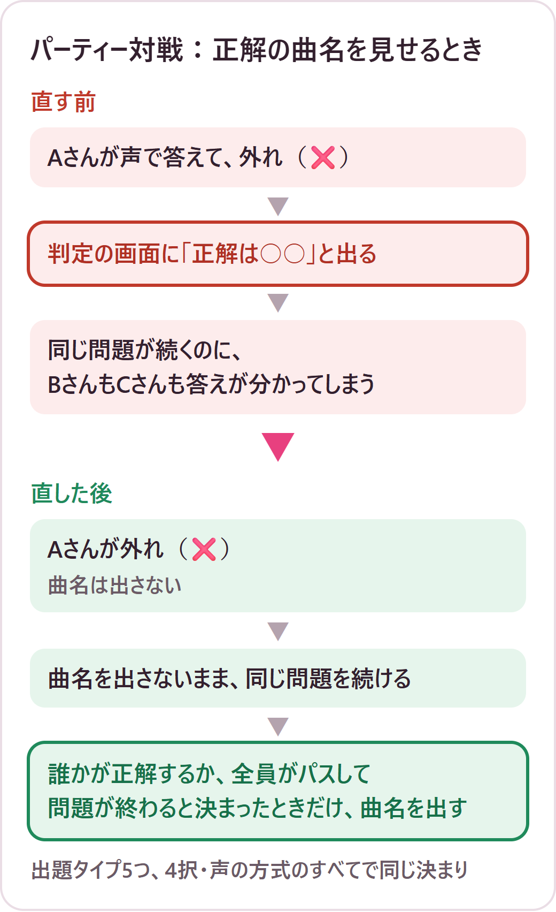

- **気づいたこと**：パーティー対戦を自分の iPhone で遊んで確かめていたとき（2回目の確認）、声で答える方式の判定画面に、正解の曲名が出ていることに気づきました。外れ（❌）のあとも同じ問題が続くのに、全員が答えを知ってしまいます。
- **判断と理由**：問題が続く可能性がある間は、正解の曲名を出さない。同じ問題が続くのに、答えが分かってしまうからです。
- **採用した仕様**：正解の曲名を出すのは、誰かが正解するか全員がパスして、問題が終わると決まったときだけ。出題タイプ5つ（イントロ・ランダム再生・アウトロ・一瞬・歌詞）と、4択・声で答える方式のすべてで同じ決まりにしました。

声で答える方式で、あわせて決めたこと（パーティー対戦の7回の実機確認の中で決めたもの。クリックで開く）

- 答える権利は、いちばん先にボタンを押して指を離した人のもの。声の聞き取りの準備は押した瞬間から始め、マイクの準備が遅れても、答える権利をほかの人に移さない。先に押してすぐに言った人が、マイクの準備待ちで不利にならないようにするためです。
- 声の聞き取りミスで外れになったときは、正解を見せたあとで判定を直せるようにする。毎回の確認画面は出さない。ふだんのゲームのテンポを変えずに、正しく言ったのに外れになった人を救うためです。
- 人が聞けばだいたい分かる答えは、なるべく自動で正解にする。ただし、別の曲を正解にしないことを絶対の条件にし、自動で決められない答えは、その場のみんなが判定する。

- **AI による実装**：Claude Code が、問題ごとに「正解を見せてよいか」を記録する仕組みを作り、画面はそのときだけ曲名を出すようにしました。声の判定の処理も作り直しました。
- **確認できた結果**：
    - 自動チェック：出題タイプ5つと4択・声のすべての状態を画面に描いて、曲名が出るかどうかを機械で調べています。声の答えは、曲名の言い方や表記の違いを機械的に作った1,610件で、別の曲を正解にしたのは0件、自動で正解にできたのは96.2%（残りは、その場のみんなが判定）でした。これは実際の声ではなく、聞き取ったあとの文字を想定して Claude Code が作ったテスト用のデータでの結果です。
    - 実機：自分の iPhone・iPad で遊んで見つけた問題を、7回に分けて直しました。遊んで確かめたのは自分1人です（1台で複数の席を操作）。
- **まだ確かめていないこと**：3〜4人で最後まで遊んだ記録はありません。7回目の直しのあとの実機での確かめ直しと、実際の声での聞き取りの正しさも、確かめていません。

### 3. コールの区切りとタイミング

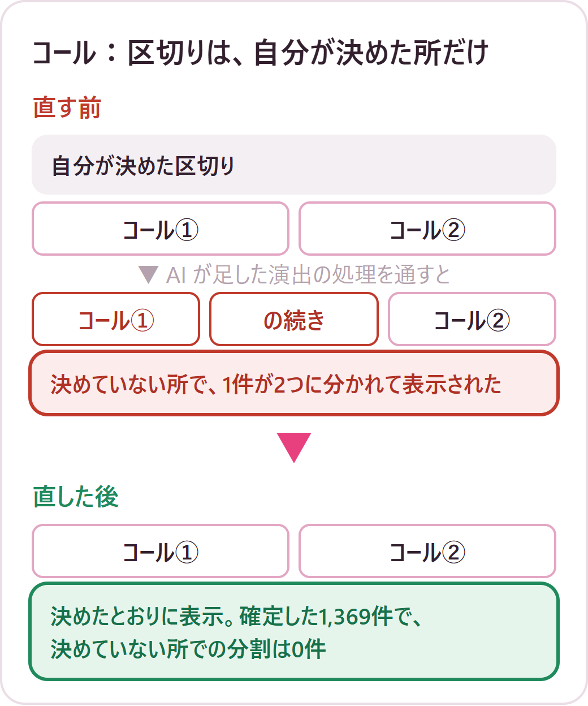

コールは1件ずつ、出す時刻と区切りを自分で確かめて確定しました。確定した1,369件のうち1,157件は、出す時刻を自分で一つずつ決めたものです（残りは、元のコール表の時刻をそのまま使いました）。

- **気づいたこと**：コールの演出を足した版を実機で見ていて、自分が区切っていないところで1件のコールが分かれて表示され、掛け声のタイミングとも合っていないことに気づきました。
- **判断と理由**：自分が区切ったところ以外では、区切らない。分かれた部分は時間を等分して出していたため、実際の掛け声のタイミングと合わなかったからです。
- **採用した仕様**：確定した1件を1つのまとまりとして、その件の時刻の間だけ全文を出す。自分が決めた時刻で2件が重なる2か所は、重なっている間、両方を全文で出す（これも自分が決めました）。
- **AI による実装**：原因は、演出のために Claude Code が足した処理でした。Claude Code がその処理を消して表示を作り直し、前の版なら失敗するテスト（表示のまとまりが、確定した件と1対1になっているか）も足しました。
- **確認できた結果**：自分が確定した1,369件を Claude Code が調べ、自分が区切っていないところでの分割は0件でした。
- **まだ確かめていないこと**：直した版（v414、11月3日公開）は、まだ iPhone の実機で確かめていません。

### 4. 友達の記録が消えたとき

- **気づいたこと**：6週目に、友達から「称号（遊んだ記録に応じてもらえるバッジ）と推しメン（応援しているメンバー）が消えた」と連絡がありました。ブラウザのサイトデータを削除したため、端末の記録がまとめて消えていました。バックアップの機能は同じ週に入れていましたが、送るのはデータが変わったときだけで、この友達の記録はまだ一度も送られていませんでした。
- **判断と理由**：アプリを開いたとき（スタート画面を出すたび）にも、バックアップを試みるようにする。データが変わらないまま遊んでいた人は、一度もバックアップが作られないままになるからです。
- **採用した仕様**：スタート画面を出すたびにバックアップを試みる（前と同じ内容なら書き込まない）。通信に失敗したら、次に試みるときにもう一度送る。管理者の画面で、公開プロフィールを出している人のうち、バックアップが1件もない人を見つけて、その場でバックアップを作れる。
- **AI による実装**：Claude Code が、バックアップを送るタイミングの追加と、管理者の画面を作りました。友達の記録を戻す処理（公開プロフィールに残っていた称号と最推しから、バックアップを作り直す）も、Claude Code が作りました。
- **確認できた結果**：友達の称号（取った日は戻らない）と、最推し（いちばんの推しメン）の1人は戻せました。プレイ履歴・自己ベストなどは、どこにも残っておらず、戻せませんでした。
- **まだ確かめていないこと**：開くたびに試みるようにしたあと、保存されない人がどれだけ減ったかは測っていません。バックアップは必ず保存できるものではなく、通信に失敗し続けたときや、送る前に端末のデータが消えたときは、戻せないことがあります。

### このほかに決めたこと（抜粋）

- **答え合わせの直後0.5秒は、［次の問題へ］を押せない**（歌詞クイズ・一瞬チャレンジ）。自分が遊んでいて、急いで押して答え合わせの表示を飛ばしてしまったため（7週目）。
- **戻ると、前に見ていた場所に戻る**。一覧の画面から戻るたびに上から探し直さないよう、スクロールの位置を戻すことにした（8月）。長いページでは、左上に小さな「‹ 戻る」も出す（v407）。
- **ホームを区画に分け、上の目次で移動する**。遊びたいモードを迷わず探せるよう、いくつかの案の中から自分が選んだ（15週目・v393）。

## 制作の進め方と AI の使い方

個人制作です。プログラムの実装の大部分は、生成AIの Claude Code に依頼しました。自分の仕事は、何を作るか、どう遊ぶか、どう直すかを決めることと、実機で確かめることでした。

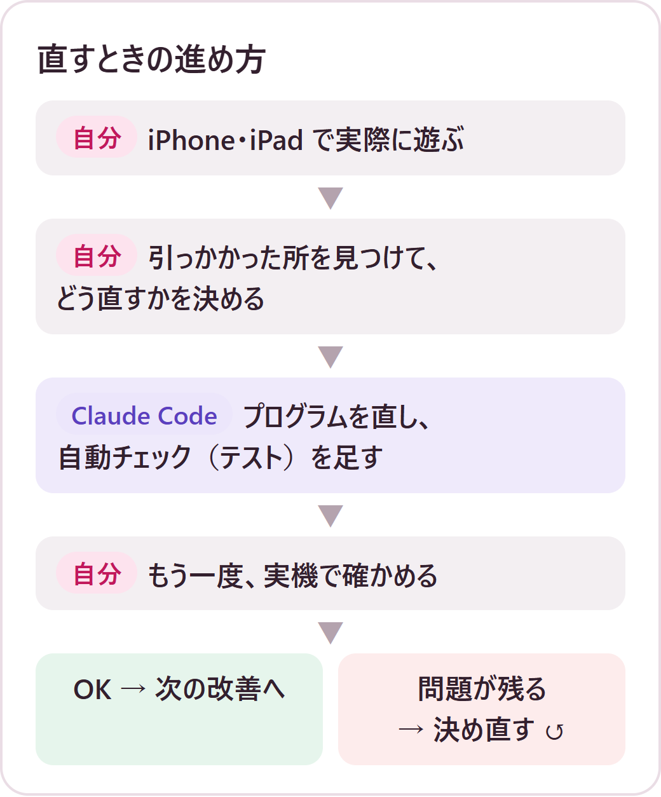

公開と実機での確認の順番は、時期によって違います。11月からは自分の方針で、自動チェックなどが通ったら先に公開し、そのあと自分が iPhone で確かめる順にしました（v414 は、[まだ確かめていないこと](#まだ確かめていないこと)にあるとおり、実機での確認がまだです）。

- **自分**：企画、ゲームのルール、仕様の判断、画面の見た目と使いやすさの方針、実機（iPhone・iPad）での確認、問題を見つけること、直し方を決めること、完成の判断
- **Claude Code**：プログラムの実装、自動チェック（テスト）の作成、技術的な調査
- **ChatGPT**：仕様の整理、設計の相談、レビュー、Claude Code への指示文の整理

AI に任せるところと、自分で決めるところは分けるようにしました。たとえば「AI は本番のデータベース（Firebase）に勝手に触らない」は、自分が決めた作業の決まりです。

制作期間は約15週です。2026年7月22日に始めて、2週目に最初の版を公開し、v414 を15週目の11月3日に公開しました。コミット（変更の記録）は v414 を公開した時点で661件で、その多くは Claude Code が作業の区切りごとに作ったものです。この README の数字と画面は v414 の時点のものです（11月23日に、ライブコールのデータの読み込みなどを直した v415 を公開しました）。

冒頭の「聴くほど分かる。でも、聴くほど点が減る。」は、完成後に、このゲームのおもしろさを説明する言葉として、AI が出した言い直しの案から自分が選んだものです。この README の文章と図も、Claude Code と作りました（書いた事実は、開発の記録とコードで確かめています）。

## 大学の学園祭での展示

2026年11月14日・15日の学園祭で、所属している情報処理研究会の展示として、このアプリをタブレットに入れて置き、来場者に遊んでもらいました。ふだんの開発では会わない人に自分で紹介して、遊んでいる様子をその場で見ることができました。その場では、アイドルのファンの方から「すごい」、来場した保護者の方から「こういうゲームが作れるんだ」という声をもらいました。遊んだ人の数やアンケートなどの記録は取っていません。

## まだ確かめていないこと

- オンライン対戦は、7週目に自分を含む3人・3台（iPhone・Android を含む）で6つのモードを確かめました。そのあと作り直した部分と、10人での対戦は、まだ試していません。
- パーティー対戦は、自分ひとりで複数の席を操作して確かめました。実際に3〜4人で最後まで遊んだ記録はまだありません。
- v414 の変更（コールの表示の直しなど）は、まだ iPhone の実機で確かめていません。Android の実機での確認も、v414 ではまだです。11月23日に公開した v415 の実機での確認も、記録にありません。
- パーティー対戦の7回目の直しのあとと、回答ボタンのスクロールの不具合を直したあとの、実機での確かめ直しは記録にありません（自動チェックでは確かめています）。

## 自動チェック（テスト）

自動チェック（テスト）は Claude Code が作り、ブラウザのテスト環境（`tests.html`）で動かしています。v414 の時点で22,568件、すべて成功です。自動チェックは「決めたとおりに動くか」を確かめるもので、人が遊んで問題がないことや、面白さを確かめるものではありません。下の4つは、どれも上の事例で自分が決めた決まりを確かめるものです。

- 回答ボタン：押したまま外へずらしたときや、スクロールしたときに、答えが決まってしまわないか
- パーティー対戦：外した人がいても、問題が終わるまで正解の曲名が出ないか（すべての状態）
- コール：表示のまとまりが、自分が確定したコール1件ずつと1対1になっているか
- 声で答える方式：別の曲を正解にしてしまわないか

## 権利について

- 公開アプリとこのリポジトリには、曲の音源・歌詞・コールのデータは入っていません（置き場の `assets/*/local/` と、`data-packs/` に置くデータは Git の対象外です）。曲データ（`js/data/songs.js`）にあるのは、曲名などの情報だけです。
- 遊ぶには、音源などのデータを、遊ぶ人が端末でファイル（ZIP など）を選んで、ブラウザの中（IndexedDB）に読み込みます。この方式にしたからといって、著作権の問題がなくなるわけではありません。
- 作品紹介動画には、曲の音は入っていません（流れているのは別の BGM です）。
- アプリ内の画像（お祝いの演出など）は、自分が画像生成AIで作ったものです。MV などのサムネイルは YouTube から直接表示していて、このリポジトリには入れていません。
- 非公式のファン制作物で、＝LOVE および権利者・関係各社とは関係ありません。
- このリポジトリのコード（HTML / CSS / JavaScript）は [MIT ライセンス](LICENSE) です。コードだけに当てはまり、曲・歌詞・コール・画面に写っている曲名などの権利とは関係ありません。

## 開発者向けの情報

技術構成・全体の構成図・フォルダの見方・ローカルでの起動方法（クリックで開く）

**技術構成**

- 画面と遊びの処理：HTML / CSS / JavaScript（ES Modules で分割）。UI フレームワークは使っていません。
- PWA：Service Worker（`sw.js`）がアプリのファイルを端末に保存して、オフラインでの起動と、新しい版への入れ替えを行います。
- Firebase Realtime Database：オンライン対戦・ランキング・フレンドの公開プロフィール・クラウドバックアップ。ログインは匿名認証です（機種変更などに備えて、メールアドレスで同じアカウントに戻れるようにする機能もあります）。
- 端末の中の保存：IndexedDB（読み込んだ音源・歌詞・コール）、localStorage（履歴・苦手曲・お気に入り・設定）
- Firebase に保存するもの：対戦の部屋、ランキング、フレンド用の公開プロフィール（表示名・称号・推しメンなど。ほかの利用者からも見える情報です）、バックアップ（端末の記録のコピー）
- 音：曲の再生は HTML の audio 要素、効果音は Web Audio API
- GitHub Actions：YouTube の出演情報（YouTube Data API v3）と、公式サイトのお知らせのタイトル・日付・リンクを取り込んで、公開用のデータを作り直してから GitHub Pages に公開します（11月9日から毎日 3時23分〈日本時間〉に始まる設定。それまでは週1回）。
- 質問AI：生成AIではありません。質問の言葉を、アプリに登録したデータの名前の一覧と言い方の一覧で読み取り、決まった文の型で答えます。端末の中だけで動き、質問は外に送りません。答えに使ったデータ（根拠）も出します。
- 外部から読み込んでいるもの：Firebase の JavaScript SDK（v10.7.1）、Google Fonts、YouTube の動画のサムネイル画像（出演情報や MV の一覧で表示）

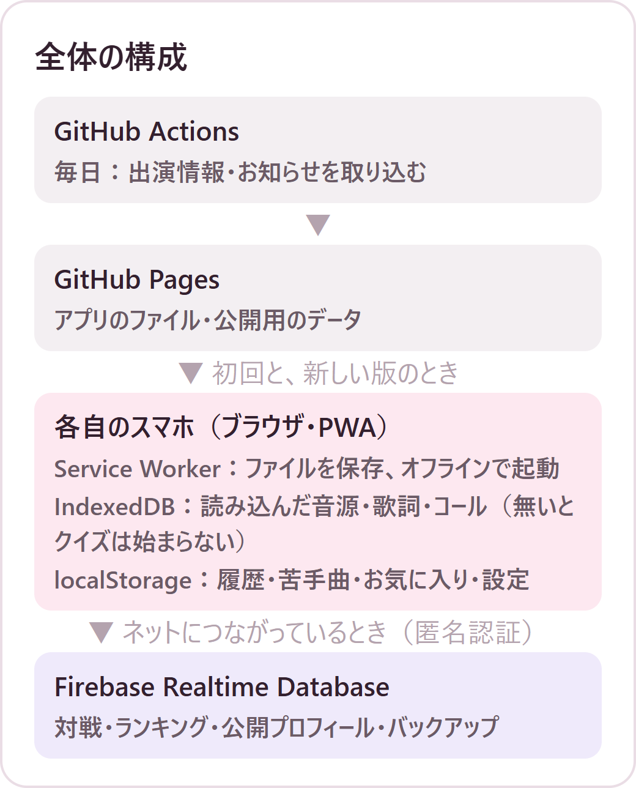

**フォルダの見方**

- `index.html`・`js/`・`css/`：アプリ本体（画面と遊びの処理）
- `tests/`・`tests.html`：自動チェック（公開サイトには載せていません）
- `dev/`：作者用の編集ツール（コール・歌詞のエディターなど。公開サイトには載せていません）
- `scripts/`・`.github/workflows/`：出演情報・お知らせを毎日取り込んで公開する仕組み
- `firebase/`：データベースの読み書きの決まり（Rules）
- `assets/`：アイコン・ガイドの画像など。音源・歌詞・コールの置き場（`local/`）は Git に入れていません
- `data-packs/`・`guide-data-pack.html`：データを端末に読み込む仕組み（データパック）の説明

**ローカルでの起動方法**

ES Modules を使っているので、`index.html` をダブルクリックで開いても動きません（ブラウザの制限です）。簡単なローカルサーバーで開いてください。

- VSCode の「Live Server」拡張機能で、このフォルダを開き、`index.html` を右クリック →「Open with Live Server」

